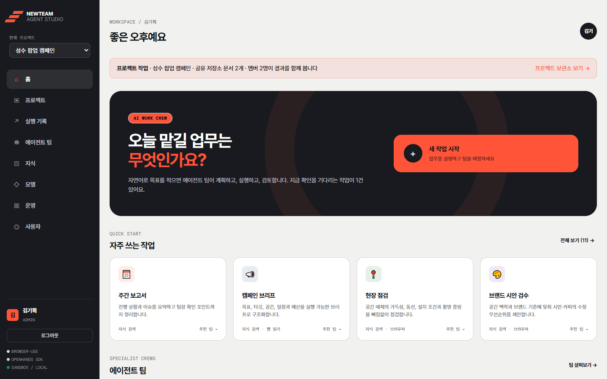
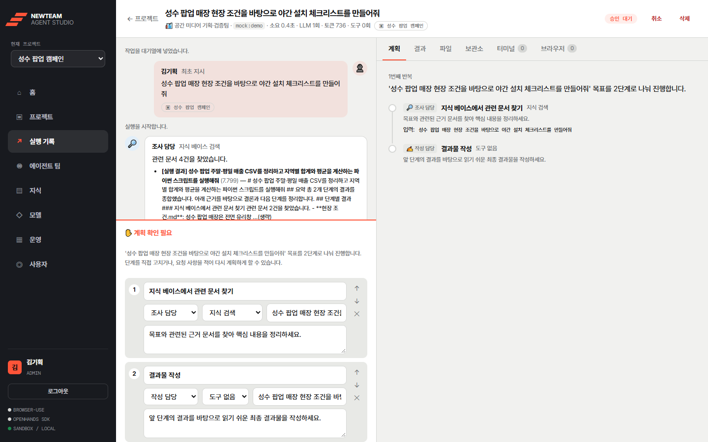
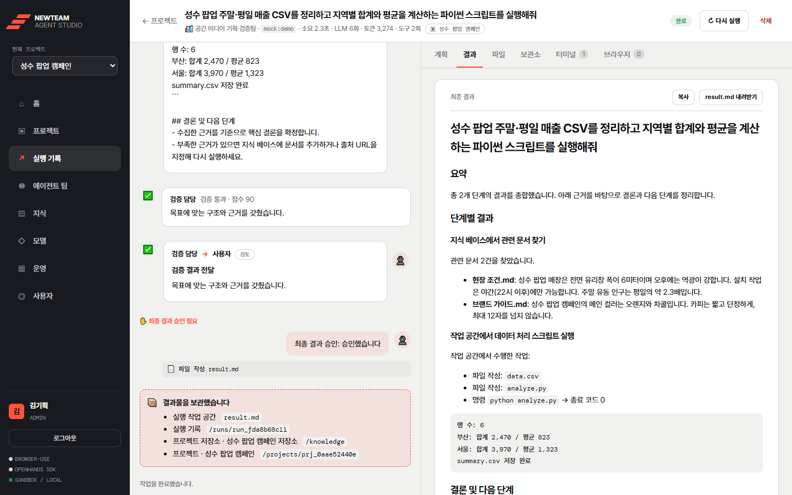
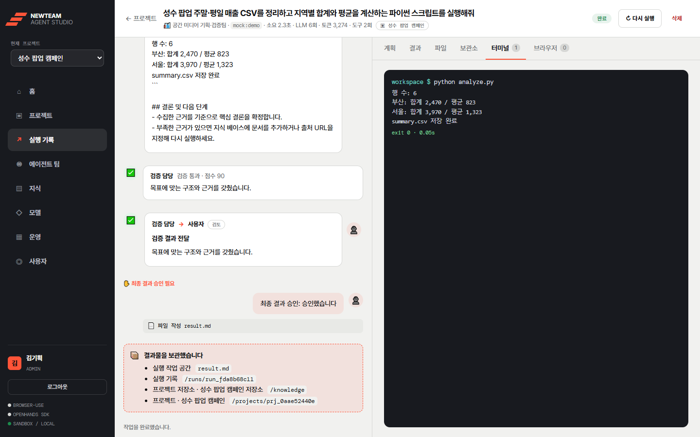
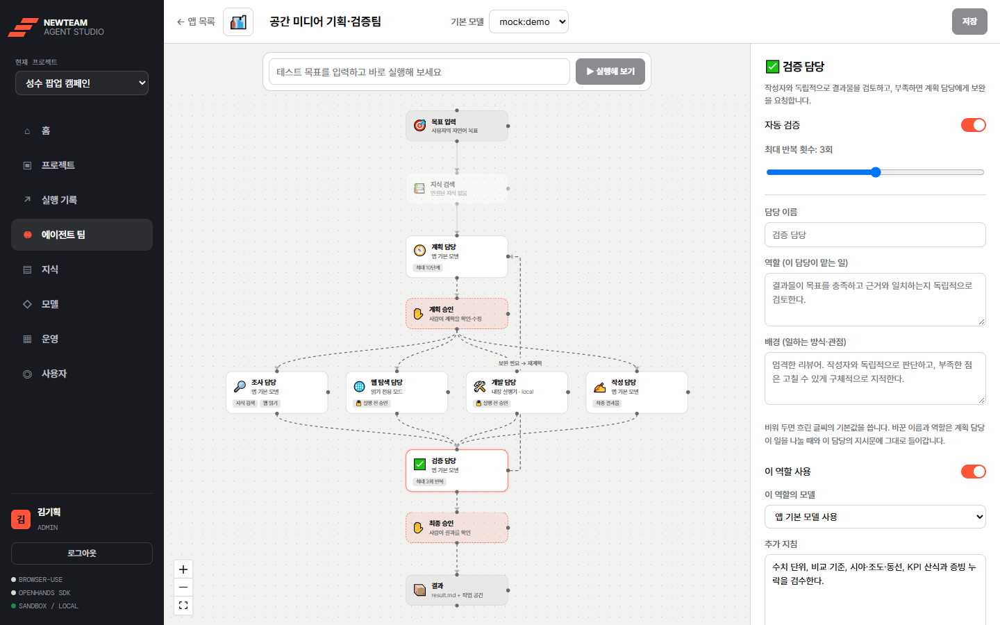
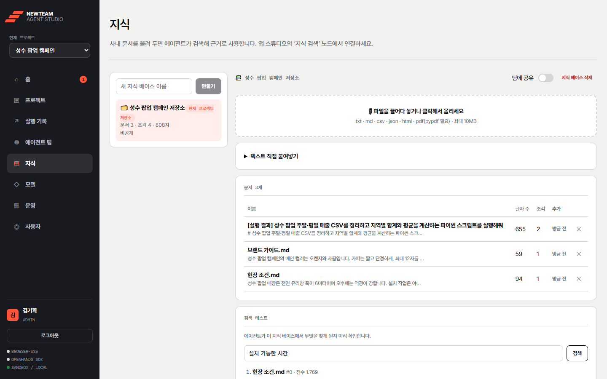
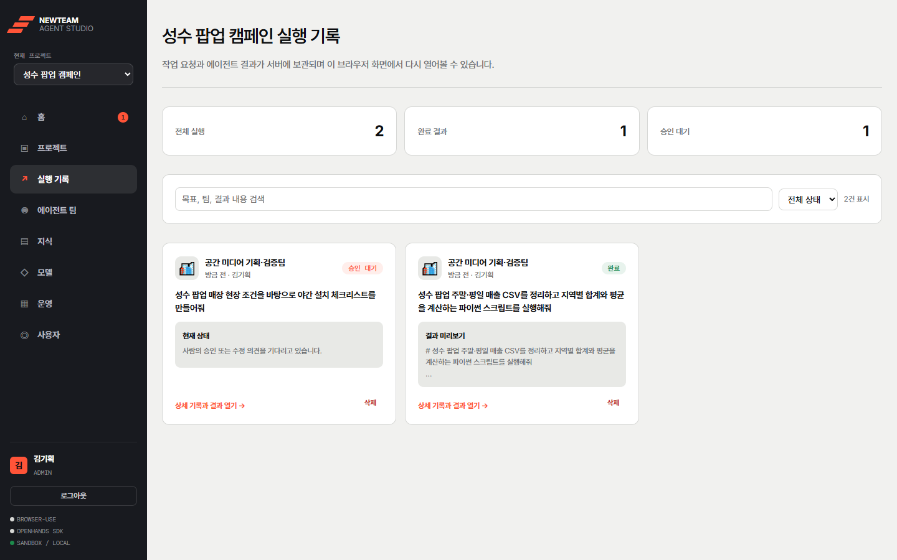

# NewTeam Studio

> 자연어로 목표를 주면 **역할별 AI 에이전트 팀**이 계획하고, 사람의 승인을 받아 실행하고, 스스로 검증해서 결과를 돌려주는 협업형 AI 에이전트 플랫폼




AutoGPT·Dify·OpenHands·CrewAI·LangGraph·browser-use의 강점을 한 제품 안에서 조합했습니다. "AI가 알아서 다 한다"보다 **사람이 중요한 지점에서 확인하고, 팀이 같은 근거를 공유하는** 실무형 에이전트를 목표로 만들었습니다.

## 핵심 기능

| 기능 | 설명 |
|---|---|
| 🎯 **목표 → 계획 → 실행 → 결과** | 자연어 목표를 계획 담당이 단계로 나누고 조사·웹 탐색·개발·작성 담당에게 위임합니다. 검증 담당이 독립적으로 검토하고 부족하면 스스로 재계획합니다. |
| ✋ **사람의 개입(Human-in-the-loop)** | 계획 승인·수정, 명령 실행 전 승인·건너뛰기, 최종 결과 승인 지점에서 실행이 멈춥니다. 일시정지·재개·실패 단계 재시도를 지원하고, 서버를 재시작해도 이어서 실행할 수 있습니다. |
| 🧩 **시각적 팀 설계** | 워크플로 캔버스에서 노드를 눌러 역할 이름·역할·모델·지침, 도구, 승인 정책, 반복 횟수를 설정합니다. |
| 🗂️ **프로젝트 공유 저장소** | 같은 프로젝트의 멤버는 저장소·팀·실행 기록·통계를 함께 씁니다. 완료된 결과물은 저장소에 쌓여 다음 작업의 근거가 됩니다. |
| 🛡️ **격리된 코드 실행** | 에이전트가 만든 코드는 강화된 Docker 컨테이너에서 실행됩니다. 네트워크 차단 또는 허용 목록 프록시를 쓰고, root가 아니며, 권한 제거·읽기 전용·자원 제한을 적용합니다. |
| 🔑 **멀티 모델·멀티 사용자** | Anthropic Claude, OpenAI, Google Gemini, OpenAI 호환(Ollama 등)을 역할별로 섞어 씁니다. 계정·권한·공유를 지원하고, API 키 없이 동작하는 데모 모델이 있습니다. |

## 화면

| 사람의 승인을 기다리는 실행 | 결과와 보관 위치 |
|---|---|
|  |  |
| **격리된 작업 공간의 실행 로그** | **워크플로 캔버스로 팀 설계** |
|  |  |
| **프로젝트 공유 저장소와 검색 테스트** | **프로젝트 실행 기록** |
|  |  |

> 화면의 프로젝트·사용자·문서는 모두 시연용 가상 데이터이며, 데모 모델(`mock:demo`)로 실행한 결과입니다.

## 기술적으로 고민한 것

- **실행 흐름을 상태 그래프로:** LangGraph `StateGraph`와 `interrupt()`로 사람의 승인 지점을 만들고, SQLite 체크포인트로 일시정지·재개·실패 재시도·서버 재시작 복구를 같은 방식으로 처리했습니다. 승인 직전에 모델을 부르는 노드와 승인 노드를 나눠, 재개할 때 모델 호출이 반복되지 않게 했습니다.
- **격리를 테스트로 증명:** "격리했다"는 말 대신 실제 컨테이너 안에서 서버 DB 찾기, 외부 접속, root 쓰기, API 키 환경 변수 유출, 시간 초과 후 컨테이너 잔존, 포크 폭탄, 허용 목록 우회를 시도하는 테스트를 두었습니다. 시간 초과 시 `docker` 클라이언트만 죽고 컨테이너는 남는 문제도 이 과정에서 찾아 고쳤습니다.
- **권한 모델을 한 곳에서:** 소유자·공유·프로젝트 멤버 권한을 두 개의 판정 함수로 모았습니다. 다른 사람의 실행에는 403이 아니라 404를 돌려줘 존재 여부도 드러내지 않습니다.
- **공급자 차이를 흡수:** OpenAI와 Gemini를 같은 Chat Completions 경로로 처리하고, 구조화 출력(JSON 스키마)으로 계획·검증 응답의 형식을 강제했습니다. 실제 API에 보내 보며 Gemini 특유의 오류 응답(배열 본문, 잘못된 키에 400)을 찾아 맞췄습니다.
- **외부 의존 없이 검색:** 임베딩 서비스 없이 BM25와 한국어 2-gram 색인으로 문서를 검색해, 키 없이도 근거 검색 흐름이 동작합니다.

## 동작 흐름

```
목표 입력 → 지식 검색 → 계획 → [사람: 계획 승인] → 조사·웹 탐색·개발·작성 → 검증 ─┬→ [사람: 최종 승인] → 결과
                          ▲                                                     │
                          └──────────────── 보완 필요 시 재계획 ─────────────────┘
```

## 참고 프로젝트에서 가져온 것

| 참고 프로젝트 | 가져온 강점 | 이 프로젝트에서 구현한 곳 |
|---|---|---|
| **AutoGPT** | 자연어 목표, 반복 실행, 실행 현황 관리 | **작업** 화면: 목표 입력창, 작업 템플릿 5종, 상태별 실행 목록과 진행률. 검증 실패 시 자동 재계획(최대 반복 횟수 설정) — [TasksPage.tsx](frontend/src/pages/TasksPage.tsx), [templates.py](backend/newteam/templates.py) |
| **Dify** | 시각적 워크플로, 문서 검색, 모델 관리, 운영 화면 | **앱 스튜디오**: 노드를 눌러 설정하는 워크플로 캔버스. **지식**: 문서 업로드·분할·검색 테스트. **모델**: 공급자 키 관리와 연결 테스트. **운영**: 통계·승인 대기·실패·로그 — [StudioPage.tsx](frontend/src/pages/StudioPage.tsx), [knowledge.py](backend/newteam/knowledge.py), [llm/registry.py](backend/newteam/llm/registry.py) |
| **browser-use** | API 없는 웹사이트 탐색·조작 | **웹 탐색 담당**의 브라우저 도구. browser-use가 설치되어 있으면 실제 브라우저를 조작하고, 없으면 HTTP로 본문만 읽는 모드로 동작 — [tools/browser.py](backend/newteam/tools/browser.py) |
| **OpenHands SDK** | 코드 수정, 명령 실행, 작업 공간 관리 | 실행마다 따로 쓰는 **작업 공간**, 강화된 Docker 샌드박스, OpenHands 에이전트 위임 모드. 실행 화면의 파일·터미널 탭 — [tools/workspace.py](backend/newteam/tools/workspace.py), [RunPage.tsx](frontend/src/pages/RunPage.tsx) |
| **CrewAI** | 역할별 협업과 작업 위임 | 계획·조사·웹 탐색·개발·작성·검증 6개 역할(역할/목표/배경). 계획 담당이 단계를 담당자에게 위임하고 검증 담당이 독립적으로 검토 — [crew.py](backend/newteam/crew.py) |
| **LangGraph** | 상태 관리, 중단·재개, 사람의 개입 | 전체 실행 흐름을 `StateGraph`로 구성. `interrupt()`로 계획·도구·최종 승인 지점에서 멈추고, SQLite 체크포인트로 일시정지·재개·실패 단계 재시도·서버 재시작 복구 — [engine/graph.py](backend/newteam/engine/graph.py), [engine/runner.py](backend/newteam/engine/runner.py) |

## 화면 구성

- **작업** — 목표를 적거나 템플릿을 골라 실행. 내 실행 현황을 상태별로 확인(관리자는 ‘전체’ 전환 가능).
- **실행 상세** — 왼쪽은 역할별 에이전트의 대화 타임라인과 사람의 개입 패널(계획 수정·재계획 요청, 명령 수정·건너뛰기, 최종 승인), 오른쪽은 계획 / 결과 / 파일 / 터미널 / 브라우저 탭.
- **앱 스튜디오** — 에이전트 앱(팀)과 워크플로 캔버스. 노드를 누르면 역할별 모델·지침, 도구, 승인 정책, 반복 횟수를 설정. ‘팀에 공유’로 다른 사용자도 쓰게 할 수 있음.
- **지식** — 지식 베이스 생성, 파일 업로드(txt·md·csv·json·html, pdf는 선택), 검색 테스트, 팀 공유.
- **모델** — 데모(오프라인), Anthropic Claude, **OpenAI**, OpenAI 호환(로컬·기타) 공급자 설정과 연결 테스트(관리자 전용).
- **운영** — 최근 7일 실행 수, 성공률, 소요 시간, 토큰·도구 사용량, 승인 대기, 실패, 실행 로그, 사용자별 통계(관리자).
- **사용자** (관리자) — 계정 만들기, 역할 변경, 비밀번호 재설정, 비활성화. **내 계정** — 이름·비밀번호 변경.

## 빠르게 시작하기 (내 PC에서 개발)

필요한 것: Python 3.11 이상, Node.js 20 이상.

```powershell
# 1) 백엔드
cd backend
python -m venv .venv
.venv\Scripts\python -m pip install -r requirements.txt     # macOS/Linux: .venv/bin/python

# 2) 프런트엔드 빌드 (백엔드가 frontend/dist를 함께 제공)
cd ..\frontend
npm install
npm run build

# 3) 실행 → http://127.0.0.1:8000
cd ..\backend
.venv\Scripts\python -m newteam
```

처음 접속하면 **관리자 계정 만들기** 화면이 나옵니다. 기본 모델은 **데모(오프라인)**(`mock:demo`)라서 API 키 없이 전체 흐름(계획 → 승인 → 작업 공간에서 스크립트 실행 → 검증·재계획 → 결과)을 체험할 수 있습니다. 데모 모델은 정해진 규칙으로 응답하므로 결과물 내용은 예시 수준입니다.

프런트엔드를 고치면서 개발할 때는 백엔드를 켠 상태에서 `cd frontend && npm run dev`로 http://localhost:5173 을 엽니다.

## 계정과 권한

| | 멤버 | 관리자 |
|---|---|---|
| 실행 기록 | 내 것만 | 내 것 + ‘전체’ 보기 |
| 앱·지식 베이스 | 내가 만든 것 수정, 공유된 것 읽기·실행 | 모두 수정 |
| 모델 키 | 볼 수 없음(모델 이름만 선택) | 설정·연결 테스트 |
| 사용자 관리 | – | 계정 생성·역할·비활성화 |

- 처음 만든 계정이 관리자가 되고, 계정 기능 이전의 실행·앱·지식은 이 계정으로 넘어갑니다.
- 기본은 **관리자가 계정을 만들어 주는 방식**입니다. 셀프 가입을 열려면 `NEWTEAM_ALLOW_SIGNUP=1`.
- 비밀번호는 scrypt로 해시해 저장하고, 세션은 HttpOnly·SameSite=Lax 쿠키입니다. 같은 IP·이메일로 10분에 5번 로그인에 실패하면 잠시 막힙니다.
- 공유 앱에 비공개 지식 베이스가 연결되어 있으면, 다른 사용자가 실행할 때는 그 지식 베이스를 검색하지 않습니다.

## 모델 연결

**모델** 화면(관리자)에서 공급자를 설정한 뒤, **앱 스튜디오**에서 앱의 기본 모델이나 역할별 모델을 고릅니다.

- **OpenAI** — API 키를 붙여 넣고 **모델 불러오기**를 누르면 그 키로 쓸 수 있는 채팅 모델 목록이 나옵니다. 쓸 모델을 체크하고 저장하세요. 키를 비워 두면 `OPENAI_API_KEY` 환경 변수를 씁니다. 계획·검증처럼 형식이 정해진 응답은 OpenAI의 엄격한 JSON 스키마 모드(structured outputs)로 받습니다.
- **Google Gemini** — [aistudio.google.com/apikey](https://aistudio.google.com/apikey)에서 받은 키를 넣고 **모델 불러오기**로 쓸 모델을 고릅니다. 키를 비워 두면 `GEMINI_API_KEY`를 씁니다. Gemini의 OpenAI 호환 엔드포인트를 쓰며, 계획·검증 응답은 JSON 스키마 모드로 받습니다.
- **Anthropic Claude** — API 키를 입력하거나 `ANTHROPIC_API_KEY`를 설정합니다. 기본 모델: `claude-opus-5-5`, `claude-sonnet-5-5`, `claude-haiku-5-5`. 앱의 ‘추론 강도’(effort)가 전달되고, Opus/Sonnet은 안전 분류기 거절 시 서버 측 대체 모델을 사용합니다.
- **OpenAI 호환 (로컬·기타)** — Ollama·vLLM·LM Studio 같은 서버. Base URL(예: `http://localhost:11434/v1`)을 넣고 모델을 불러오거나 직접 입력합니다.

> API 키는 서버의 로컬 SQLite 파일(`backend/data/newteam.db`)에 평문으로 저장됩니다. 키를 환경 변수로만 주입하면 파일에 남지 않습니다.

## 작업 공간 보안 (샌드박스)

에이전트(개발 담당)는 작업 공간에서 실제로 명령을 실행합니다. 실행 위치는 두 가지입니다.

| 모드 | 격리 | 용도 |
|---|---|---|
| `local` (기본) | **없음.** 서버와 같은 권한으로 실행되어 서버의 DB·API 키 파일을 읽을 수 있음 | 내 PC에서 혼자 개발할 때만 |
| `docker` | 실행마다 일회용 컨테이너: 네트워크 차단, root 아님, 리눅스 권한 전부 제거, 권한 상승 차단, 읽기 전용 루트, 메모리 512MB·CPU 1개·프로세스 128개 제한, 작업 공간 폴더만 마운트, 서버 환경 변수 미전달. 시간이 넘으면 컨테이너를 강제 종료 | 다른 사람이 접속할 때 |

- **서버 모드**(`NEWTEAM_MODE=server`, 또는 `NEWTEAM_HOST`를 127.0.0.1 외 주소로 열 때)에서는 `local` 실행과 OpenHands 로컬 실행을 **거부**합니다. 화면 왼쪽 아래에도 경고가 표시됩니다.
- Linux 서버에서는 `NEWTEAM_DOCKER_RUNTIME=runsc`로 **gVisor**를 켤 수 있습니다(gVisor 설치 필요). 컨테이너가 호스트 커널 대신 gVisor의 사용자 공간 커널을 쓰므로 커널 취약점을 통한 탈출 위험이 크게 줄어듭니다.
- 격리 테스트([test_sandbox.py](backend/tests/test_sandbox.py))는 실제 컨테이너 안에서 서버 DB 찾기, 외부 네트워크 접속, root 권한·루트 파일시스템 쓰기, API 키 환경 변수 유출, 시간 초과 후 컨테이너 잔존, 포크 폭탄, 허용 목록 밖 접속·프록시 우회를 시도해 모두 막히는지 확인합니다. Docker가 꺼져 있으면 이 테스트들은 건너뜁니다.
- **인터넷이 필요한 작업(pip install)** — 기본은 네트워크 완전 차단입니다. `NEWTEAM_SANDBOX_ALLOWLIST=pypi.org,files.pythonhosted.org`(또는 `start-server.ps1 -AllowPyPI`)로 설정하면, 샌드박스는 외부와 끊긴 내부 Docker 네트워크(`newteam-sandbox`)에만 붙고 같은 네트워크의 squid 프록시(`newteam-egress`)를 거쳐 **허용 목록 도메인에만** 나갈 수 있습니다. 다른 사이트·IP 직접 접속·프록시 우회는 막힙니다. 설치한 패키지는 작업 공간의 `.pydeps`에 들어가 같은 실행 안에서 계속 쓸 수 있습니다.

### 구조적으로 지키는 것

| 원칙 | 현재 상태 |
|---|---|
| 비밀 정보를 샌드박스에 넣지 않기 | API 키·DB는 서버 프로세스에만 있습니다. 컨테이너에는 작업 공간 폴더만 마운트하고, 환경 변수는 `HOME`·파이썬 설정·프록시 주소만 넘깁니다(테스트로 확인). |
| docker.sock 노출 금지 | 서버는 컨테이너가 아닌 일반 프로세스로 실행합니다. 서버를 컨테이너로 옮길 때 `/var/run/docker.sock`을 마운트하지 마세요. 그 서버가 호스트 root 권한을 갖게 됩니다. 꼭 필요하면 별도 샌드박스 호스트나 rootless Docker를 쓰세요. |
| 샌드박스를 별도 VM에서 실행 | Windows + Docker Desktop에서는 컨테이너가 WSL2 VM 안에서 돌고 서버·DB·키는 Windows 쪽에 있어, 이미 VM 경계로 나뉩니다. Linux 서버에서 같은 구조를 원하면 샌드박스 전용 VM을 두고 [workspace.py](backend/newteam/tools/workspace.py)의 `Workspace.run`만 그쪽(또는 E2B)을 부르도록 바꾸면 됩니다. 나머지 엔진은 이 함수만 사용합니다. |
| 네트워크는 허용 목록으로 | 위 프록시 방식. 기본은 완전 차단입니다. |
| Windows는 Docker Desktop, Linux는 gVisor | `start-server.ps1`은 Docker Desktop을 전제로 합니다. Linux 서버에서는 `NEWTEAM_DOCKER_RUNTIME=runsc`. |

## 다른 PC에서 함께 쓰기 (소규모 공유)

소수(2~3명)에게 잠깐 써 보게 할 때의 가장 간단한 방법입니다. 내 PC가 켜져 있는 동안만 접속됩니다.

1. **Docker Desktop을 켭니다.**
2. **서버 모드로 실행합니다.**
   ```powershell
   powershell -ExecutionPolicy Bypass -File .\start-server.ps1
   ```
   Docker 확인, 프런트엔드 빌드, 샌드박스 이미지 준비 후 `NEWTEAM_MODE=server`, `NEWTEAM_SANDBOX=docker`로 서버를 켭니다.
3. 브라우저에서 http://127.0.0.1:8000 → **관리자 계정 생성** → **모델** 화면에서 OpenAI 키 입력 → **사용자** 화면에서 지인 계정 2개 생성.
4. **외부에서 접속할 수 있게 연결합니다.** 둘 중 하나를 고르세요.
   - **Tailscale (권장, 비공개)** — 나와 지인이 Tailscale을 설치하고 내 PC를 공유(Share)합니다. 지인은 `http://<내PC의 Tailscale 이름>:8000`으로 접속합니다. 인터넷에 공개되지 않습니다. 이 경우 `.\start-server.ps1 -BindHost 0.0.0.0`으로 실행하세요(Windows 방화벽 허용 창이 뜨면 ‘개인 네트워크’만 허용).
   - **Cloudflare 임시 터널 (설치 간단, 공개 주소)** — `cloudflared tunnel --url http://localhost:8000` 을 실행하면 `https://….trycloudflare.com` 주소가 나옵니다. 누구나 로그인 화면까지는 볼 수 있으니 비밀번호를 길게 정하고, 이때는 `.\start-server.ps1 -Https`로 실행해 쿠키에 Secure 속성을 붙이세요.
5. 지인에게 주소와 이메일·임시 비밀번호를 전달합니다. 지인은 **내 계정**에서 비밀번호를 바꿀 수 있습니다.

테스트가 끝나면 서버와 터널을 끄고, 필요하면 **사용자** 화면에서 계정을 비활성화하세요. 모든 사용량은 내 API 키로 청구되므로 OpenAI 대시보드에서 월 사용 한도를 걸어 두는 것을 권합니다.

## 선택 통합

| 통합 | 설치 | 동작 |
|---|---|---|
| browser-use | `pip install browser-use` 후 `playwright install chromium` | 실제 모델을 쓰는 앱에서 웹 탐색 담당이 브라우저를 직접 조작합니다. 미설치·데모 모델이면 HTTP 읽기 전용 모드. |
| OpenHands SDK | `pip install openhands-sdk openhands-tools` | 개발 담당의 실행 엔진을 ‘OpenHands SDK’로 바꾸면 OpenHands 에이전트가 작업 공간에서 직접 개발합니다. 로컬에서 실행되므로 서버 모드에서는 막힙니다. |
| PDF 문서 | `pip install pypdf` | 지식 베이스에 PDF를 올릴 수 있습니다. |

browser-use와 OpenHands 연결은 각 프로젝트의 공개 예제 API를 기준으로 작성했으며, 두 라이브러리를 설치한 상태의 동작은 테스트에 포함되어 있지 않습니다.

## 환경 변수

| 이름 | 기본값 | 설명 |
|---|---|---|
| `NEWTEAM_HOST` / `NEWTEAM_PORT` | `127.0.0.1` / `8000` | 서버 주소 |
| `NEWTEAM_MODE` | `dev` | `server`면 local 샌드박스 실행 거부. HOST가 127.0.0.1 밖이면 자동으로 server |
| `NEWTEAM_DATA_DIR` | `backend/data` | DB·체크포인트·작업 공간 위치 |
| `NEWTEAM_SANDBOX` | `local` | `local`(개발용) 또는 `docker` |
| `NEWTEAM_DOCKER_RUNTIME` | – | `runsc`면 gVisor 사용(Linux) |
| `NEWTEAM_DOCKER_IMAGE` | `python:3.12-slim` | 샌드박스 이미지 |
| `NEWTEAM_DOCKER_MEMORY` / `_CPUS` / `_PIDS` | `512m` / `1` / `128` | 컨테이너 자원 제한 |
| `NEWTEAM_COMMAND_TIMEOUT` | `60` | 명령 실행 제한 시간(초) |
| `NEWTEAM_SANDBOX_ALLOWLIST` | – | 샌드박스가 프록시로 접속할 수 있는 도메인(쉼표 구분). 비우면 네트워크 완전 차단 |
| `NEWTEAM_ALLOW_LOCAL_SANDBOX` | `0` | `1`이면 서버 모드에서도 local 실행 허용(위험) |
| `NEWTEAM_ALLOW_SIGNUP` | `0` | `1`이면 누구나 회원가입 |
| `NEWTEAM_SECURE_COOKIE` | `0` | HTTPS로 서비스하면 `1` |
| `NEWTEAM_SESSION_DAYS` | `14` | 로그인 유지 기간 |
| `ANTHROPIC_API_KEY` / `OPENAI_API_KEY` / `GEMINI_API_KEY` | – | 모델 화면에서 키를 비워 두면 사용 |

## 구조

```
backend/
  newteam/
    engine/graph.py     LangGraph 실행 그래프 (노드·사람 개입·재계획)
    engine/runner.py    백그라운드 실행, 일시정지/재개/취소, 체크포인트 복구
    auth.py             계정·세션·권한(소유자/공유)
    projects.py         프로젝트·공유 저장소·이미지 시안·댓글
    crew.py             역할 정의 (CrewAI 패턴)
    apps.py             에이전트 앱 설정과 기본값
    templates.py        작업 템플릿 (AutoGPT 패턴)
    knowledge.py        문서 분할 + BM25 검색 (한국어 2-gram 색인)
    llm/                모델 공급자: anthropic / openai·gemini·호환 서버(OpenAI 형식) / mock
    tools/              web(HTTP 읽기) · browser(browser-use) · workspace(샌드박스·OpenHands)
    api.py              FastAPI (REST + SSE 실행 스트림)
  tests/                엔진·API·계정·OpenAI·샌드박스 테스트 (pytest)
frontend/
  src/pages/            작업 · 실행 상세 · 앱 스튜디오 · 지식 · 모델 · 운영 · 사용자 · 내 계정 · 로그인
start-server.ps1        서버 모드 실행 스크립트 (Windows)
docs/screenshots/       README 화면 캡처
```

API 목록은 서버 실행 후 http://127.0.0.1:8000/docs 에서 볼 수 있습니다.

## 테스트

```powershell
cd backend
.venv\Scripts\python -m pip install -r requirements-dev.txt
.venv\Scripts\python -m pytest -q          # Docker가 켜져 있으면 실제 컨테이너 격리 테스트까지 실행

cd ..\frontend
npm run typecheck
```
